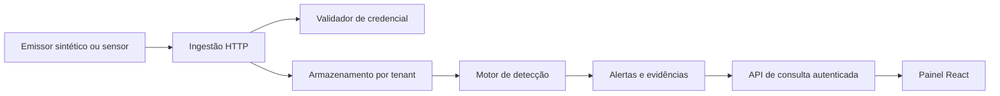

# Escopo e arquitetura

## Resultado inicial

Um evento sintético de autenticação entra no Watch, é validado e armazenado; uma regra explica se há sinal de ataque; um analista consulta o alerta e suas evidências. O fluxo deve continuar demonstrável localmente sem serviços pagos.

## Módulos e limites

| Módulo | Responsabilidade | Primeira entrega funcional | Evolução |
| --- | --- | --- | --- |
| Ingestão | Receber e normalizar eventos | HTTP local validando um evento | Credenciais, limites e despacho confiável |
| Identidade | Autenticar máquinas e autorizar acesso | Emissão e verificação local de chave | Revogação, escopos e identidade humana |
| Armazenamento | Persistir e consultar por tenant | SQLite local com retenção curta | Paginação, expurgo e exportação |
| Detecção | Transformar eventos em sinais explicáveis | Regra determinística de autenticação | Janela temporal, deduplicação e triagem |
| Painel | Mostrar alertas e evidências | Lista com fixtures locais | Consulta autenticada e atualização em tempo real |
| Coletor | Produzir eventos sem coletar dados pessoais | Emissor sintético por CLI | Retry limitado e sensor Linux consentido |
| Infraestrutura | Reproduzir e proteger o ambiente | Ambiente local isolado | Worker/D1 e VM Oracle opcionais |
| DevSecOps | Verificar código, dependências e operação | CI dos módulos existentes | SAST, segredos, dependências e exercício integrado |

## Tecnologias propostas

- Ingestão: TypeScript, Cloudflare Workers, Wrangler e Vitest; execução local primeiro.
- Core: Elixir e ExUnit; Phoenix acrescentado quando a API/streaming justificar. Sem Broadway ou GraphQL no início.
- Dados: SQLite local; D1 na borda para credenciais/metadados quando houver deploy. Evitar duas fontes de verdade para o mesmo dado.
- Interface: React, Vite, testes de componentes e Playwright.
- Coletor: CLI TypeScript antes de estudar sensor Rust/Tauri; mobile e SDKs múltiplos ficam fora do recorte inicial.
- Operação: Terraform para os recursos remotos aprovados, contêineres locais, GitHub Actions.

Essas escolhas são propostas: registrar uma decisão curta com problema, opções, escolha e consequência antes de introduzir outra ferramenta.

## Integrações progressivas

Primeiro integrar de modo síncrono com interfaces substituíveis. Não adicionar fila antes de medir necessidade. Resposta de sucesso implica persistência, não apenas envio em background. Se futuramente houver aceite assíncrono, só responder 202 após entrega durável e documentar o caminho de falhas.

O painel nunca consulta Axiom com chave privilegiada nem acessa diretamente o banco. O servidor aplica autorização e tenant em cada consulta e assinatura de canal. WebSockets são um incremento posterior; consulta HTTP já deve funcionar sozinha.

## Fora do escopo inicial

Monetização, Stripe, retenção de anos, dados reais de clientes, consulta de CPF/e-mail em vazamentos, monitoramento de SMS/localização, varredura de contas OAuth, resposta automática destrutiva, alta disponibilidade e promessas de escala. Não é necessário disponibilizar a plataforma publicamente para demonstrar seus módulos.
