# Como as partes do Watch se conectam

**Este documento responde:** qual parte faz cada trabalho, com que tecnologia e por onde os dados passam. Os campos exatos ficam nos [contratos](contratos.md).

## Três caminhos para entender o sistema

```mermaid
flowchart LR
    APP["Aplicação de exemplo"] --> SDK["SDK no servidor da aplicação"]
    SDK --> ENTRADA["Entrada HTTP: TypeScript / Worker"]
    ENTRADA -->|"API interna autenticada"| CORE["Servidor principal: Elixir / Phoenix"]
    CORE --> DB[("SQLite: dados do Watch")]
    DB --> DET["Processo detector"]
    DET --> ALERTA[("Alertas e evidências")]
    ALERTA --> API["API para pessoas autenticadas"]
    API --> PAINEL["Painel React"]
```

O primeiro caminho é **receber e guardar**. O segundo é **analisar os dados guardados**. O terceiro é **consultar e tratar o alerta**. Discord e gráficos são saídas adicionais, desenhadas em [diagramas](diagramas.md).

## As peças e suas responsabilidades

| Peça | O que faz | Tecnologia e tarefas |
| --- | --- | --- |
| Contratos | Combinam mensagens e operações que duas partes precisam entender igualmente | JSON Schema/OpenAPI; C01, C02 e C03 |
| SDKs | Bibliotecas que as aplicações chamam para enviar eventos | TypeScript, Python e Go; SK01, SK05, SK06 e SK07 |
| Entrada | Recebe HTTP, valida pedido, autoriza e pede a gravação | TypeScript/Worker; IN01–IN04 |
| Identidade | Verifica chaves de envio e tokens das pessoas | Servidor Elixir; ID01–ID03 |
| Cadastro de fontes | Identifica as aplicações, seu estado e vínculos permitidos | Servidor Elixir; RG01, RG03 e RG04 |
| Armazenamento | Guarda eventos, alertas e evidências sem misturar organizações | SQLite controlado pelo servidor; ST01–ST05 |
| Detector | Aplica regras aos eventos e guarda posição para retomar | Elixir; DE01–DE08 |
| API do painel | Autoriza listagem, detalhe e alteração de status | Phoenix, o framework web de Elixir; ST05 |
| Painel | Mostra o alerta e permite reconhecer/resolver | React/Vite; UI01–UI03 |
| Fila de saída | Guarda tarefas de envio e tenta novamente dentro dos limites | SQLite e processo do servidor; NT01–NT03 |
| Exportação/gráficos | Copia resumos para Loki e os mostra no Grafana | OB01 e OB02; diagnóstico técnico local em OB03 |
| Ambiente e CI | Sobem o laboratório e verificam alterações automaticamente | Composição local, GitHub Actions e Terraform opcional; IF/DS |

“Core” nos nomes técnicos significa **servidor principal**. “Worker” é a peça TypeScript da entrada; podemos executá-la localmente sem publicar na Cloudflare.

## Quem controla o banco

O servidor Elixir controla os arquivos SQLite de credenciais, fontes, eventos, alertas e tarefas de notificação. A entrada TypeScript não abre esses arquivos: chama a API interna do servidor.

Isso evita que duas partes mantenham versões divergentes da mesma informação. Por exemplo, ao desativar uma fonte, a decisão atual precisa ser conferida antes de aceitar sua gravação.

O SQLite fica em volume local privado. O experimento com dois processos de DE05 usa o mesmo host/volume; não monta um arquivo SQLite pela rede nem transforma o experimento em infraestrutura distribuída.

## Como a entrada chama o servidor

C03 define endereços, exemplos de pedido/resposta e falhas de duas operações: verificar chave e gravar evento. Usa HTTP interno autenticado, credencial interna própria e tempo máximo de 2 segundos.

Há três credenciais com funções diferentes:

| Credencial | Quem usa | Para quê |
| --- | --- | --- |
| Chave de SDK | Aplicação que envia evento | Escrever eventos da fonte autorizada |
| Credencial interna | Entrada ao chamar servidor | Acessar as operações internas combinadas |
| Token humano | Pessoa usando painel/API | Consultar e alterar conforme organização/papel |

O evento público não pode escolher a organização. O servidor obtém esse contexto da identidade verificada. Se uma dependência necessária não responde, a entrada devolve erro.

## Como a análise retoma

Cada evento recebe uma sequência crescente na chegada, `ingest_seq`. O executor lê nessa ordem e guarda um **checkpoint**, o marcador de até onde terminou.

O alerta usa uma chave estável da ocorrência para não ser duplicado quando o executor reler um evento após cair. O marcador só avança depois dos efeitos guardados. Se a retenção já apagou contexto necessário, o sistema informa `coverage_gap`, uma lacuna na análise.

## Começar isolado e depois integrar

Uma interface de armazenamento pode começar com dados em memória; o painel pode começar com exemplos. Isso permite desenvolver as peças em paralelo. Esses substitutos precisam ficar identificados.

Nas issues de integração, o caminho exigido deve usar os serviços reais. Por exemplo, IN03 liga entrada, identidade, fontes e SQLite; UI02 liga a tela à API; DS03 percorre o conjunto inteiro.

## Local e remoto

O laboratório local é o caminho obrigatório. IF01 fornece a composição e os comandos de subida/encerramento. Inicialmente pode haver um perfil mínimo; DS03 precisa do perfil integrado real.

Os exercícios remotos são separados: IF04 decide onde tudo ficaria e confere custo; IF02 testa um Worker/D1 isolado; IF03 prepara um plano de máquina nova sem criar os recursos. Nenhum deles equivale a publicar automaticamente o Watch inteiro.

**Próximo passo:** consulte a [ordem das tarefas](ordem-execucao.md) e, na implementação, use os [contratos](contratos.md).
