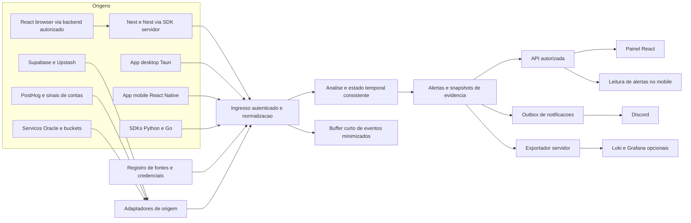

# Escopo e arquitetura

Ver também o [plano geral consolidado](plano-geral.md) e os [diagramas de sistema, identidade e atualização](diagramas.md).

## Resultado inicial

Um evento sintético de autenticação entra no Watch, é validado e armazenado; uma regra explica se há sinal de ataque; um analista consulta o alerta e suas evidências. O fluxo deve continuar demonstrável localmente sem serviços pagos.

## Módulos e limites

| Módulo | Responsabilidade | Primeira entrega funcional | Evolução |
| --- | --- | --- | --- |
| Ingestão | Receber e normalizar eventos | HTTP local validando um evento | Credenciais, limites e despacho confiável |
| Identidade | Autenticar máquinas e autorizar acesso | Emissão e verificação local de chave | Revogação, escopos e identidade humana |
| Armazenamento | Persistir e consultar por tenant | SQLite local com retenção curta | Paginação, expurgo e exportação |
| Detecção | Transformar eventos em sinais explicáveis | Regra determinística de autenticação | Janela temporal, deduplicação e triagem |
| Painel | Mostrar alertas e evidências | Lista com fixtures locais | Consulta autenticada e atualização em tempo real |
| Coletor | Produzir eventos sem coletar dados pessoais | Emissor sintético por CLI | Retry limitado e sensor Linux consentido |
| Infraestrutura | Reproduzir e proteger o ambiente | Ambiente local isolado | Worker/D1 e VM Oracle opcionais |
| DevSecOps | Verificar código, dependências e operação | CI dos módulos existentes | SAST, segredos, dependências e exercício integrado |

## Tecnologias propostas

- Ingestão: TypeScript, Cloudflare Workers, Wrangler e Vitest; execução local primeiro.
- Core: Elixir e ExUnit; Phoenix acrescentado quando a API/streaming justificar. Sem Broadway ou GraphQL no início.
- Dados: SQLite local; D1 na borda para credenciais/metadados quando houver deploy. Evitar duas fontes de verdade para o mesmo dado.
- Interface: React, Vite, testes de componentes e Playwright.
- Produtores: SDK TypeScript server-side, adaptadores Next.js/NestJS, SDKs Python/Go, coletor CLI, app desktop Tauri e app mobile React Native. Cada um começa isolado com receptor local de teste.
- Saídas: Discord para notificação resumida; Loki/Grafana como exportação e dashboard opcionais. O painel React continua funcionando sem Grafana.
- Operação: Terraform para os recursos remotos aprovados, contêineres locais, GitHub Actions.

Essas escolhas são propostas: registrar uma decisão curta com problema, opções, escolha e consequência antes de introduzir outra ferramenta.

## Módulos complementares do sistema

| Módulo | Primeira entrega | Incrementos seguintes |
| --- | --- | --- |
| Gestão de fontes | Cadastro manual por tenant | Pareamento individual e heartbeat |
| SDKs | Envio server-side TypeScript | Next, Nest, browser via backend, Python e Go |
| Conectores | Adaptadores de origem com fixtures | Supabase, Upstash, PostHog, Vercel e Oracle |
| Desktop | Tauri Linux com envio sintético | Sensores por SO e lifecycle explícito |
| Mobile | App Android com envio em primeiro plano | Secure storage, postura, background, iOS e consulta de alertas |
| Notificações | Alerta no Discord | Entrega com retry e roteamento |
| Observabilidade | Exportação de alertas para Loki | Dashboard Grafana e cobertura da pipeline |
| Contas | Matriz de sinais disponíveis | Uma importação de laboratório autenticada |

O [mapa de origens e cobertura](origens-e-cobertura.md) descreve a visão completa e suas limitações.

## Integrações progressivas

Primeiro integrar de modo síncrono com interfaces substituíveis. A outbox de notificações é um incremento próprio para sobreviver a falhas de entrega; não exige uma plataforma de filas externa. Resposta de sucesso implica persistência, não apenas envio em background. Se futuramente houver aceite assíncrono, só responder 202 após entrega durável e documentar o caminho de falhas.

O painel nunca consulta Axiom com chave privilegiada nem acessa diretamente o banco. O servidor aplica autorização e tenant em cada consulta e assinatura de canal. WebSockets são um incremento posterior; consulta HTTP já deve funcionar sozinha.

## Fora do escopo inicial

Monetização, Stripe, retenção de anos, dados reais de clientes, consulta de CPF/e-mail em vazamentos, monitoramento de SMS/localização, varredura de contas OAuth, resposta automática destrutiva, alta disponibilidade e promessas de escala. Não é necessário disponibilizar a plataforma publicamente para demonstrar seus módulos.

## Modos de execução

O modo local cobre todos os contratos e exercícios sem serviços pagos. A borda Cloudflare é um deploy opcional, com gate de custo e estado de correlação autoritativo. O core Elixir pode continuar local; deploy remoto requer capacidade gratuita separada. A VPS Oracle que atende outros projetos não é pressuposto nem alvo do Watch. Adotar um modo remoto exige documentar onde roda cada componente e quais dependências permaneceram locais; publicar apenas o Worker não equivale a publicar todo o SOC.

Terraform gerencia recursos suportados pelos providers, bindings, dashboards e configurações. Build de SDKs/apps, assinatura, instalação, consentimento, contas e permissões não são resolvidos por Terraform. Separar provisionamento de infraestrutura, release de binários e onboarding operacional.
