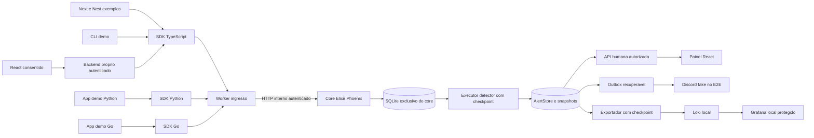
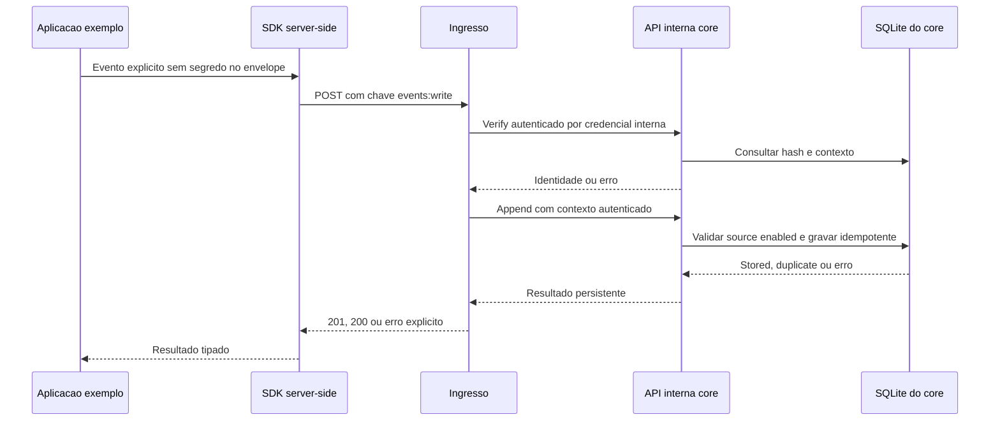
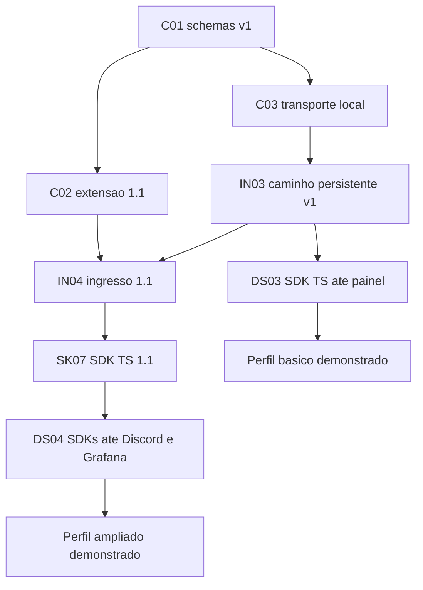

# Diagramas do escopo vigente

Descrevem o laboratório planejado, não capacidades já implementadas. Somente SDKs server-side enviam ao ingresso; setas de Discord/Loki são saídas.

O core revalida source/status na gravação; contexto arbitrário no body não autoriza tenant. Detector lê o buffer depois do aceite, por ingest_seq; sucesso HTTP não promete detecção imediata. Queda de processo é tratada por checkpoint/replay e falha de entrega por outbox. Expurgo anterior à análise gera lacuna explícita.

Este desenho resume capacidades; a lista completa de bloqueios está no backlog e nas issues. IF04 decide remoto antes de IF02 smoke e IF03 plano; nenhum deles publica automaticamente o SOC completo.
