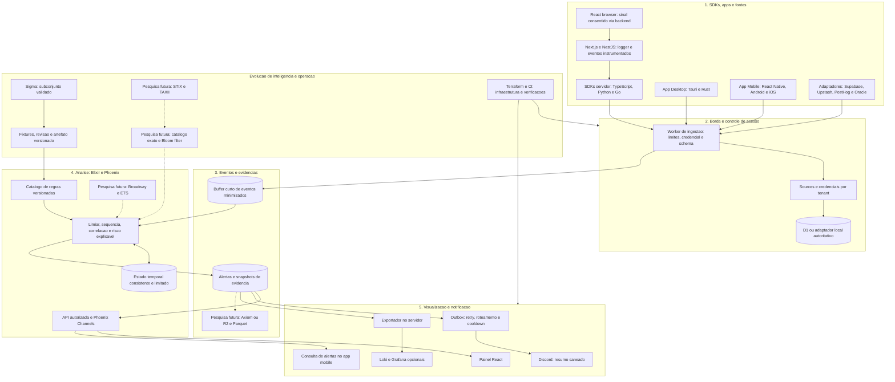
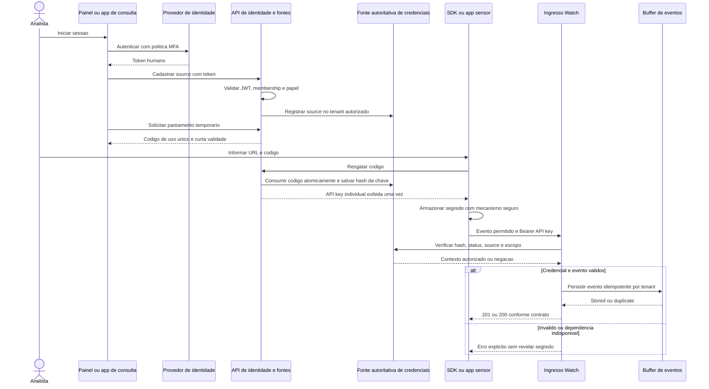
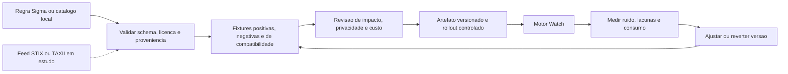

# Diagramas gerais do Watch

Código Mermaid incorporado à documentação, editável e renderizado no GitHub. Estes diagramas consolidam os planos de arquitetura, detecção e identidade; descrevem o sistema pretendido, não componentes já implementados. O [plano geral](plano-geral.md) explica as decisões e o [backlog](backlog.md) identifica incrementos.

## Visão geral: origens, borda, core e saídas

Linhas contínuas representam fluxos planejados no backlog atual. Linhas tracejadas representam extensões em estudo, condicionadas a teste, privacidade e custo. SDKs/agentes enviam diretamente ao Watch; adaptadores externos ampliam a cobertura quando a plataforma oferece o sinal.

O buffer protege o caminho de reprocessamento e mantém contexto limitado. A evolução para processamento por fila/stream exige aceite durável e falhas especificadas. Não encaminhar somente eventos que bateram em IoC: a correlação também precisa de eventos sem indicador conhecido.

## Autenticação humana, pareamento e ingestão de máquina

SDKs server-side podem receber URL e API key diretamente da configuração secreta do operador; pareamento é o caminho de onboarding dos dispositivos. O browser utiliza o backend da aplicação e não armazena essa chave. Revogação é conferida na fonte autoritativa; KV não garante invalidação global instantânea.

## Atualização de regras e inteligência

Atualizar regras não equivale a executar Terraform recebido de um feed. Provisionamento de infraestrutura e promoção de conteúdo analítico são responsabilidades distintas. STIX/TAXII, Bloom filters e adoção de Broadway permanecem propostas de pesquisa descritas no plano geral.

## Ajustes em relação ao desenho inicial

- Incluir mobile, SDKs, Discord, Grafana e registro de fontes na mesma visão.
- API autorizada entre frontend e dados; remover acesso direto do React ao D1 e credenciais de busca.
- Validação autoritativa de credenciais; remover a hipótese de latência zero e revogação instantânea por KV.
- Separar esquema reduzido Watch de futura conversão OCSF e separar regras determinísticas de pesquisa avançada.
- Retenção curta/evidência seletiva como base; Axiom, R2 premium e recursos de monetização como alternativas futuras.
- Revisão e testes antes de promover regras/feeds; sem promessa de detecção infalível, escala ilimitada ou custo garantido em qualquer volume.
