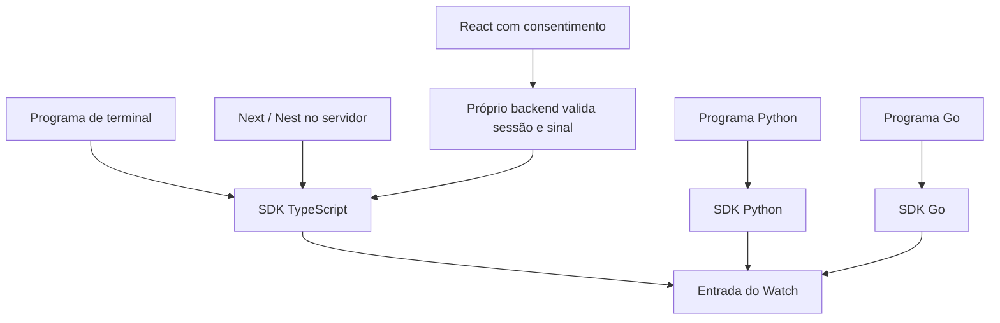
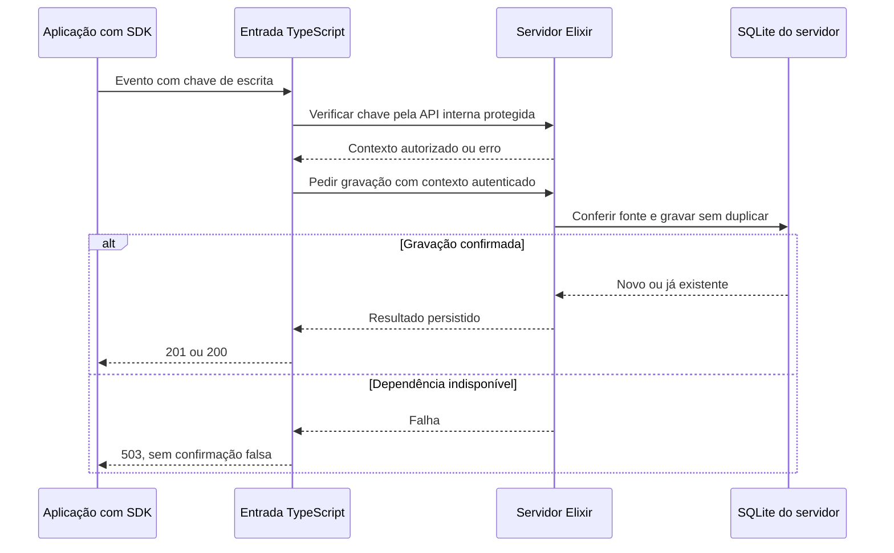
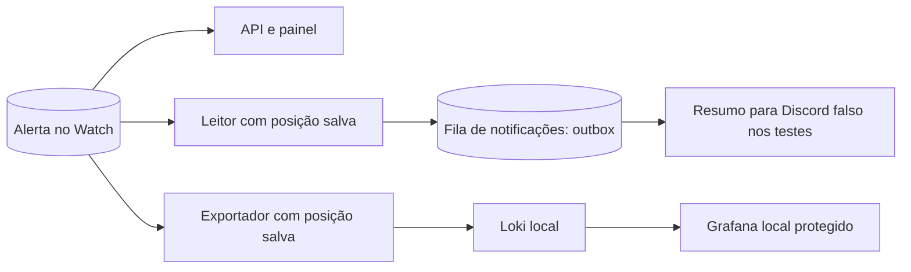
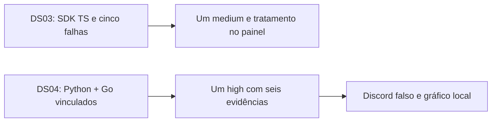

# O projeto em desenhos

**Use este documento para:** acompanhar visualmente uma mensagem. As regras exatas estão nos [contratos](contratos.md), e os programas/línguas estão na [arquitetura](arquitetura.md).

## 1. Do acontecimento ao alerta

Leia da esquerda para a direita. A aplicação decide relatar; o SDK envia; o Watch guarda; o detector analisa o que foi guardado; o painel consulta o alerta.

```mermaid
flowchart LR
    APP["Aplicação relata falha de login"] --> SDK["SDK monta e envia evento"]
    SDK --> ENT["Entrada verifica pedido e chave"]
    ENT --> SRV["Servidor principal confere fonte"]
    SRV --> DB[("Guarda evento no SQLite")]
    DB --> DET["Detector procura sequência de falhas"]
    DET --> ALERT[("Guarda alerta e evidência")]
    ALERT --> API["API confere usuário e organização"]
    API --> UI["Painel mostra e permite tratar alerta"]
```

O detector lê depois da gravação. Confirmar que recebeu um evento não significa que ele já foi analisado. Um alerta guarda os eventos que justificaram a regra; não é só uma luz vermelha sem explicação.

## 2. Por onde entram os dados

Todos os caminhos chegam ao mesmo ingresso por SDK server-side. React passa pelo próprio backend para que a chave fique protegida.

Não há coleta de dados da hospedagem ou de contas externas nesse desenho. A chave de SDK não aparece no React.

## 3. O que acontece se algo falhar no recebimento

Pedidos inválidos são rejeitados antes de guardar. O servidor controla a organização e a fonte; um campo recebido do cliente não concede permissão.

## 4. Saídas do alerta e retomada

A fila mantém tarefas após reinício. O exportador guarda até onde confirmou envio. Uma falha no destino não apaga o alerta original. Após aceite externo e perda da confirmação, pode ocorrer duplicata de mensagem/cópia, conforme os limites do contrato.

## 5. Nossos dois resultados completos

Esses desenhos não são um grafo completo de dependências. Para escolher a próxima tarefa, use a [ordem de execução](ordem-execucao.md); para dividir o trabalho, use o [guia da dupla](trabalho-em-dupla.md).
